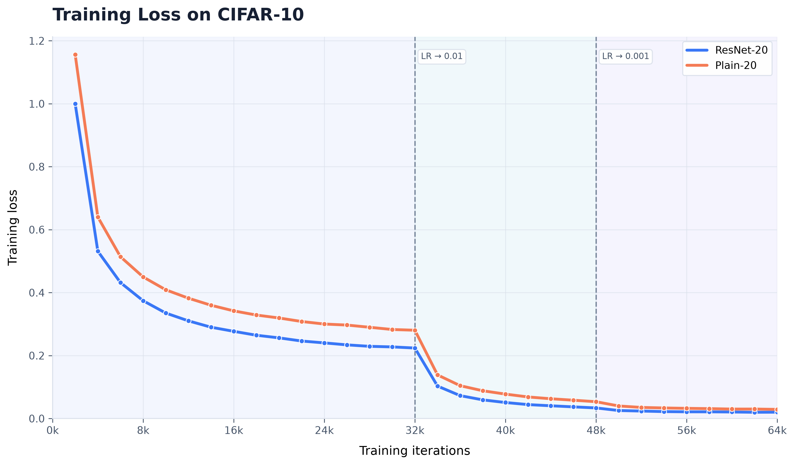
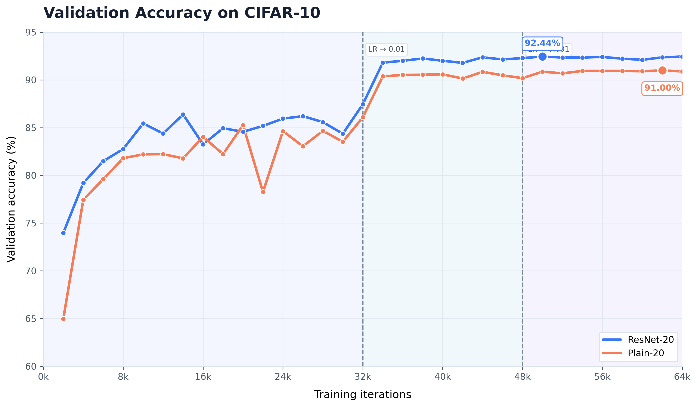

# ResNet-20 vs. Plain-20: An Ablation Study on CIFAR-10

**A PyTorch implementation and empirical comparison of deep residual and plain convolutional neural networks.**

[](https://www.python.org/)
[](https://pytorch.org/)
[](https://www.cs.toronto.edu/~kriz/cifar.html)
[](https://www.nvidia.com/)

## Overview

Why do residual connections help deep neural networks train effectively?

This project investigates that question through a controlled comparison between **ResNet-20**, which incorporates identity shortcuts, and a **Plain-20** convolutional network with the same general depth but without skip connections.

Both architectures are implemented in PyTorch and trained on CIFAR-10 using the same data split, preprocessing pipeline, optimizer, learning-rate schedule, and training budget.

The objective is to examine how residual connections relate to optimization behaviour, validation performance, and generalization in a small-scale image-classification setting.

This repository documents an implementation and ablation experiment inspired by the original ResNet research. It is not a claim of an exact reproduction of every detail of the original paper.

## Research Questions

1. How does removing residual connections affect the optimization of a 20-layer convolutional network?
2. How do the training-loss and validation-accuracy trajectories differ between ResNet-20 and Plain-20?
3. Does the residual architecture achieve better test performance under the experimental configuration used here?

## Experimental Results

Both models were trained for 64,000 iterations on CIFAR-10 using an NVIDIA GeForce RTX 2050.

| Metric | ResNet-20 | Plain-20 |
|---|---:|---:|
| Training iterations | 64,000 | 64,000 |
| Best validation accuracy | 92.44% | 91.00% |
| Test accuracy | 91.48% | 90.19% |
| Test loss | 0.3708 | 0.4363 |

**Observed test-accuracy difference: 1.29 percentage points in favour of ResNet-20.**

The residual network also achieved lower test loss in this run. These results are consistent with the hypothesis that residual connections can facilitate optimization and improve predictive performance.

However, the experiments reported here use one training run per architecture. Multiple random seeds and statistical analysis are needed to assess the consistency and significance of the observed difference.

## Learning Curves

### Training Loss



ResNet-20 exhibits lower recorded training loss throughout the experiment. Both networks show substantial loss reductions following the learning-rate changes at iterations 32,000 and 48,000.

### Validation Accuracy



ResNet-20 maintains higher validation accuracy during most of the training run and achieves a best recorded validation accuracy of 92.44%, compared with 91.00% for Plain-20.

The validation curves provide evidence about generalization during training, while final test metrics provide a separate evaluation on the held-out test set.

## Dataset

The experiment uses the CIFAR-10 dataset, containing 60,000 colour images of size 32 × 32 pixels across ten classes.

| Split | Number of images |
|---|---:|
| Training | 45,000 |
| Validation | 5,000 |
| Test | 10,000 |

The original 50,000-image training partition is divided into training and validation subsets using a reproducible random split with seed 42. The official 10,000-image test partition is kept separate.

### Classes

Airplane, automobile, bird, cat, deer, dog, frog, horse, ship, and truck.

## Methodology

### Architecture

**ResNet-20**

- Initial 3 × 3 convolution with 16 output channels.
- Three groups of residual blocks with 16, 32, and 64 channels.
- Three basic blocks per group, with two 3 × 3 convolutions per block.
- Identity shortcuts, using Option A-style spatial downsampling and channel padding where dimensions change.
- Global average pooling followed by a fully connected ten-class classifier.

**Plain-20**

- Uses the same overall convolutional stage structure and classifier.
- Removes residual addition and identity shortcut connections.
- Retains batch normalization and ReLU activations.

The comparison is designed to isolate the effect of residual connections as closely as possible within the implemented architectures.

### Data Preprocessing

- Convert pixel values to the range [0, 1].
- Normalize using channel-wise CIFAR-10 mean and standard deviation.
- Apply random cropping after four-pixel padding during training.
- Apply random horizontal flipping with probability 0.5.
- Do not apply random augmentation to validation or test images.

### Optimization

| Hyperparameter | Value |
|---|---|
| Optimizer | Stochastic Gradient Descent (SGD) |
| Initial learning rate | 0.1 |
| Momentum | 0.9 |
| Weight decay | 0.0001 |
| Batch size | 128 |
| Training iterations | 64,000 |
| Learning-rate milestones | 32,000 and 48,000 |
| Learning-rate decay factor | 0.1 |
| Random seed | 42 |

The learning rate changes from 0.1 to 0.01 at iteration 32,000 and to 0.001 at iteration 48,000.

## Implementation Details

The models are implemented from scratch in PyTorch rather than imported from a pre-built ResNet model implementation.

The training pipeline includes:

- CIFAR-10 batch loading.
- Training-validation separation.
- Data augmentation and normalization.
- GPU-accelerated training when CUDA is available.
- Periodic validation evaluation.
- Best-validation-checkpoint selection.
- CSV logging of training loss, training accuracy, and validation accuracy.
- Final evaluation of the selected checkpoint on the held-out test set.

## Repository Structure

```text
resnet20-cifar10/
├── data/                   # Local CIFAR-10 dataset (not committed)
├── outputs/
│   ├── resnet-20/
│   │   ├── best.pt         # Best validation checkpoint
│   │   └── metrics.csv
│   ├── plain-20/
│   │   ├── best.pt
│   │   └── metrics.csv
│   ├── figures/
│   │   ├── training_loss.png
│   │   ├── training_loss.pdf
│   │   ├── validation_accuracy.png
│   │   └── validation_accuracy.pdf
│   └── summary.csv
├── models.py
├── train.py
├── evaluate.py
├── check_dataset.py
├── check_models.py
├── smoke_test.py
├── plot_results.py
├── requirements.txt
├── .gitignore
└── README.md
```

The exact contents of `outputs/` depend on which generated artifacts are retained in the repository. Model checkpoints are excluded from Git by default.

## Installation

### 1. Clone the repository

```bash
git clone <YOUR_GITHUB_REPOSITORY_URL>
cd resnet20-cifar10
```

### 2. Create a virtual environment

Windows PowerShell:

```powershell
python -m venv .venv
.\.venv\Scripts\Activate.ps1
```

### 3. Install dependencies

```bash
python -m pip install -r requirements.txt
```

For GPU training, install a PyTorch build compatible with your NVIDIA GPU and CUDA environment. Verify GPU availability using:

```bash
python -c "import torch; print(torch.cuda.is_available()); print(torch.cuda.get_device_name(0) if torch.cuda.is_available() else 'CPU')"
```

### 4. Prepare CIFAR-10

Download the official CIFAR-10 Python archive from the [CIFAR-10 dataset website](https://www.cs.toronto.edu/~kriz/cifar.html) and extract it so that the Python batches are available at:

```text
data/cifar-10-batches-py/
```

The expected files include `data_batch_1` through `data_batch_5`, `test_batch`, and `batches.meta`.

## Running the Experiments

### Verify the dataset

```bash
python check_dataset.py
```

### Run the GPU smoke test

```bash
python smoke_test.py
```

### Train both models

```bash
python train.py --steps 64000 --batch-size 128 --eval-every 2000
```

To run only one architecture:

```bash
python train.py --models resnet --steps 64000 --eval-every 2000
```

```bash
python train.py --models plain --steps 64000 --eval-every 2000
```

**Note:** The current training script starts from a fresh initialization and does not resume interrupted runs. Running the command again may overwrite previous checkpoints and metrics.

### Generate the plots

```bash
python plot_results.py
```

Generated figures are saved under `outputs/figures/`.

## Limitations and Future Work

The current experiment is a useful baseline, but several limitations remain:

- Only one random seed has been evaluated per architecture.
- The observed performance difference has not been tested for statistical significance.
- The experiment uses a single dataset and a single model depth.
- A small difference in test accuracy does not by itself establish a causal explanation for the observed behaviour.
- Exact reproduction of the original ResNet experimental protocol has not yet been independently verified.

Potential extensions include:

1. Repeating both experiments across multiple random seeds.
2. Reporting mean accuracy, standard deviation, and uncertainty estimates.
3. Investigating gradient norms and optimization stability.
4. Comparing additional depths and shortcut configurations.
5. Evaluating the effect of different learning-rate schedules and data-augmentation strategies.

## Reference

He, K., Zhang, X., Ren, S., & Sun, J. (2016). Deep Residual Learning for Image Recognition. *Proceedings of the IEEE Conference on Computer Vision and Pattern Recognition (CVPR)*, 770–778.

https://doi.org/10.1109/CVPR.2016.90
